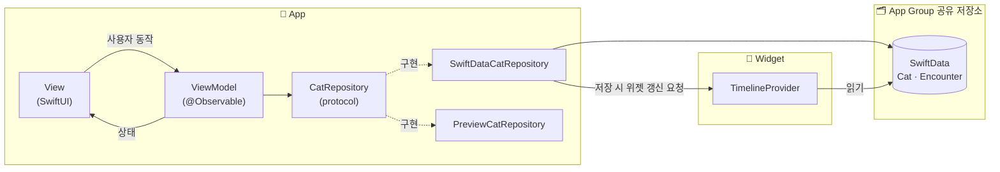

<div align="center">


# 길거리 친구들

**길에서 만난 친구들과의 추억 일기 🐾**

</div>

<br>

## 📖 소개
**길거리 친구들**은 길에서 만난 고양이를 '친구'로 등록하고,
<br>
만날 때마다 사진과 일지로 '추억'을 쌓아 언제든 돌아볼 수 있는 앱입니다.


이 앱은 치즈 고양이 **찐빵이** 덕분에 시작되었습니다.

길에서 친해진 찐빵이를 만날 때마다 반가운 마음에 사진을 찍었고, 사진첩에는 함께한 순간들이 쌓여 갔습니다.
<br>
사진뿐만 아니라 그날의 기억과 이야기도 함께 남겨 두고 싶다는 생각에서 길거리 친구들을 만들게 되었습니다.

<br>

| 개발 기간 | 개발 인원 | 플랫폼 |
| --- | --- | --- |
| 2025.08 ~ 2026.01 (1차 개발)<br>2026.11 (접근성 및 완성도 개선) | iOS 1명, 디자인 1명 | iOS 18.5+ |

<br>

## 📱 주요 기능

### 친구 등록 & 추억쌓기
| 새로운 친구 등록 | 만났던 친구 추억쌓기 | 중복 이름 안내 |
| :---: | :---: | :---: |
|  |  |  |

- 새로운 친구는 이름과 첫 추억을 함께 등록하고, 만났던 친구에게는 추억을 이어서 쌓을 수 있어요
- 이미 사용 중인 이름은 등록할 수 없도록 안내해요

### 친구 & 추억 보기
| 홈 | 친구 상세 | 추억 상세 |
| :---: | :---: | :---: |
|  |  |  |

- 가장 자주 만난 친구, 즐겨찾는 친구, 모든 친구를 한눈에 볼 수 있어요
- 친구와의 추억을 폴라로이드 카드로 모아 볼 수 있어요

### 검색 & 즐겨찾기
| 검색 | 즐겨찾기 |
| :---: | :---: |
|  |  |
| 대소문자, 띄어쓰기와 상관없이 찾고,<br>일치하는 글자를 강조해요 | 하트를 누르면 홈의<br>즐겨찾는 친구에 바로 추가돼요 |

### 친구 · 추억 공유
| 친구 공유 카드 | 추억 공유 카드 |
| :---: | :---: |
|  |  |

### 홈 화면 위젯
| 최근 친구 | 이달의 TOP 친구 |
| :---: | :---: |
|  |  |

### 첫만남 기념일 알림
<!-- 알림 배너 스크린샷 -->
- 친구를 처음 만난 날로부터 매년 n주년에 알림을 보내고, 알림을 누르면 그 친구의 상세 화면으로 이동해요

<br>

## ♿ 접근성
모든 사용자가 길거리 친구들을 쓸 수 있도록, 접근성을 기능 개발과 같은 비중으로 다뤘습니다.

| 항목 | 내용 |
| --- | --- |
| **VoiceOver** | 아이콘 버튼 라벨, 카드 묶어 읽기, 모달 처리, 토스트·오류 음성 안내, 로터 머리말 이동 |
| **Dynamic Type** | 텍스트 스타일 기준 크기 조절, 큰 글자에서 잘림·겹침 방지, 내비게이션 바 큰 콘텐츠 뷰어 |
| **색상 대비** | Apple HIG 기준 점검, 대비 증가(Increase Contrast) 설정 대응 |
| **터치 영역** | 아이콘 버튼 최소 44×44pt |

<br>

## 🛠 기술 스택
| 분류 | 기술 |
| --- | --- |
| UI | SwiftUI |
| 데이터 | SwiftData, App Group (앱 · 위젯 데이터 공유) |
| 위젯 | WidgetKit |
| 알림 | UserNotifications (로컬 알림) |
| 아키텍처 | MVVM, Repository 패턴 |
| 협업 | Git, GitHub (Issue · PR 템플릿), Figma |

<br>

## 🏗 아키텍처
### MVVM + Repository

View는 화면만 그리고, ViewModel이 화면 상태와 로직을 담당해요.
데이터 저장은 `CatRepository` 프로토콜 뒤에 숨겨서, ViewModel은 SwiftData를 직접 알지 않아요.



| 계층 | 역할 | 예시 |
| --- | --- | --- |
| **View** | 화면 그리기, 사용자 입력 전달 | `HomeView`, `EncounterInputView` |
| **ViewModel** | 화면 상태 관리, 입력 검증, Repository 호출 | `HomeViewModel`, `CatDetailEditViewModel` |
| **Repository** | 데이터 생성·조회·수정·삭제, 이름 중복 검사 | `CatRepository`, `SwiftDataCatRepository` |
| **Model** | SwiftData 모델 | `Cat`, `Encounter` |

### 주요 설계

**1. Repository를 Environment로 주입**
- `CatRepository`를 SwiftUI `Environment`로 주입해, 실제 앱에서는 `SwiftDataCatRepository`, Preview에서는 `PreviewCatRepository`를 사용해요
- 주입을 빠뜨리면 기본값인 `DevNullCatRepository`가 바로 오류를 내서, 실수를 빨리 발견할 수 있어요

**2. 앱과 위젯이 같은 데이터를 사용**
- `SharedModelContainer`가 App Group 폴더에 SwiftData 저장소를 만들고, 앱과 위젯이 같은 저장소를 사용해요
- 모델(`Cat`, `Encounter`)과 "이번 달 가장 자주 만난 친구" 계산(`MonthlyTopCat`)을 두 타깃이 함께 써서, 홈 화면과 위젯의 결과가 항상 같아요
- 데이터가 바뀌면 Repository가 `WidgetCenter`로 위젯 갱신을 요청해요

**3. Router로 화면 이동 관리**
- `NavigationStack`의 경로를 `Router`가 관리해, 어느 화면에서든 `push` / `popToRoot`로 이동해요
- 기념일 알림을 탭하면 `DeepLinkStore` → `Router`를 거쳐 해당 친구의 상세 화면으로 바로 이동해요

**4. 공통 UI는 컴포넌트로 분리**
- 내비게이션 바, 입력 필드, 알림창, 토스트 등을 컴포넌트로 만들어 화면 간 디자인과 접근성 처리를 통일했어요

### 폴더 구조

```
StreetFriends
├── App                  # 앱 진입점, AppDelegate (알림 처리)
├── Data
│   ├── Models           # SwiftData 모델 (Cat, Encounter)
│   ├── Repositories     # CatRepository 프로토콜과 구현체
│   └── Shared           # 앱·위젯 공용 (저장소 설정, 월간 TOP 계산)
├── ViewModels           # 화면별 ViewModel
├── Views
│   ├── Screens          # 화면 단위 View
│   └── Components       # 재사용 UI 컴포넌트
└── Utils                # Router, 토스트, 알림 스케줄러, Extension

StreetFriendsWidget      # 홈 화면 위젯
```

<br>

## 💡 고민과 해결

<br>

## 🌱 배운 점

<br>

## 👥 만든 사람

| iOS | Design |
| :---: | :---: |
| <a href="https://github.com/71myo">김효정</a> | 황윤정 |
